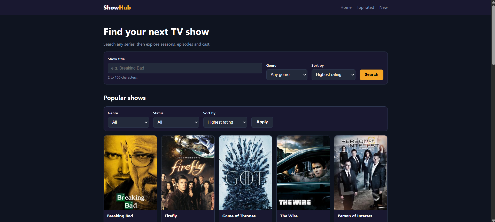
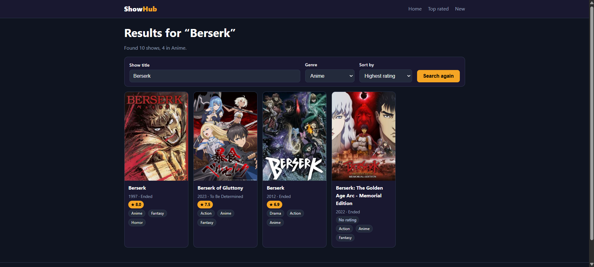
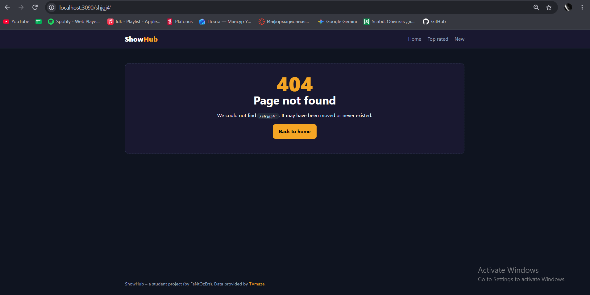

# ShowHub – TV Series Discovery and Explorer

Server-side web application built with **Express, Node.js, Axios and EJS** (MVC).
Users search TV shows, browse them by genre/status, and open detail pages with seasons, episodes and cast.

**API used:** [TVmaze Public API](https://www.tvmaze.com/api) – free, no API key needed.
Project for VR 113153 Web Development II (Individual Project, 2026).

## Features
- Search shows by title (server-side validation: 2–100 characters, must contain a letter or digit)
- Browse the show index filtered by **genre** and **status**, sorted by **rating / premiere date / title**
- Show details: poster, rating, genres, network, runtime, summary with HTML stripped
- Episodes **grouped by season** with episode count and average rating per season
- Cast list (duplicates removed) and actor profile with age and filmography
- Placeholders for missing images/ratings, "no results" states, pagination of the show index
- Dark responsive design (desktop and mobile), labeled forms, accessible focus styles
- Friendly error pages for: network errors, timeouts, 404, 429 rate limit, 5xx, invalid input, unknown routes

## Screenshots






## TVmaze requests used (Axios, `services/tvmazeService.js`)
| Request | Used for |
|---|---|
| `GET /search/shows?q=` | search results |
| `GET /shows?page=` | home page (filtered and sorted on the server) |
| `GET /shows/:id` | show details |
| `GET /shows/:id/episodes` | episodes by season |
| `GET /shows/:id/cast` | cast |
| `GET /people/:id` | actor profile |
| `GET /people/:id/castcredits?embed=show` | actor filmography |

## Routes
| Method | Route | Description |
|---|---|---|
| GET | `/` | home: search form + filtered/sorted card grid (`?genre=&status=&sort=&page=`) |
| POST | `/search` | validates form input, redirects (303) to `GET /search` |
| GET | `/search?q=&genre=&sort=` | search results (also validated) |
| GET | `/show/:id` | show details |
| GET | `/show/:id/episodes` | episodes grouped by season |
| GET | `/show/:id/cast` | cast list |
| GET | `/actor/:id` | actor profile and credits |
| * | anything else | custom 404 page |

## Project structure
```
showhub/
├── app.js                    # entry point: middleware order, 404 + error handler
├── routes/index.js           # route definitions (+ id parameter check)
├── controllers/              # home, show, actor – request handling logic
├── services/tvmazeService.js # all Axios calls, ApiError, 5-min cache
├── middleware/               # logger.js, validateSearch.js, errorHandler.js
├── utils/showUtils.js        # filter, sort, group by season, strip HTML …
├── views/ (+ partials/)      # EJS templates, header/footer/card partials
├── public/                   # css, images
├── .env.example  .gitignore  package.json
```

## Middleware
- Built-in: `express.static`, `express.urlencoded`, `express.json`
- Custom: **request logger** (method, URL, status, time), **validateSearch** (input validation)
- `notFound` (404) and a centralized `errorHandler(err, req, res, next)`

## Installation
```bash
git clone https://github.com/FaNtOzErs/ShowHub-TV-Series-Discovery-and-Explorer.git showhub
cd showhub
npm install
cp .env.example .env     # Windows: copy .env.example .env
npm start
```
Open http://localhost:3090. Optional: `npm run dev` (auto-restart).

`.env` variables: `PORT` (3090), `API_BASE_URL` (default `https://api.tvmaze.com`).

## Credits
- Data: [TVmaze](https://www.tvmaze.com/api) (CC BY-SA). 
- Documentation used: Express, Axios, EJS, MDN.
- AI assistance is described in `docs/AI_Declaration.md`.
